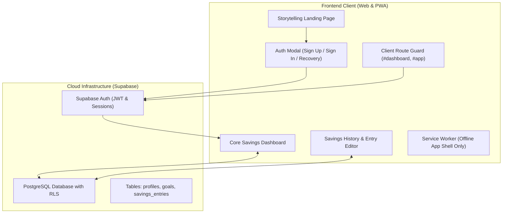

# 📋 NairaStreak Labs — Project Handoff

> **Parent Organization**: NairaStreak Labs  
> **Working Product Title**: 500K Challenge *(Temporary working name pending final consumer product naming)*  
> **Original Author**: Zuokemefa Oyinmiebi Peter (Learn2earn)  
> **Original Live Deployment**: [https://500ksavgoal.netlify.app](https://500ksavgoal.netlify.app) *(DO NOT overwrite or modify)*  
> **Target New Deployment**: Netlify (e.g. `nairastreak-web.netlify.app` / custom domain)  
> **Document Version**: 2.0 (Post-Directive Revision)  
> **Date**: October 12, 2026  

---

## 1. Directive Context & Foundation Goal

This project is undergoing a structured transition from an inherited single-file prototype into an end-to-end, production-grade web product under **NairaStreak Labs**.

### Core Tenets
1. **Parent Brand vs Product Name**:
   - `NairaStreak Labs` is the parent organization.
   - `500K Challenge` is solely a working product title. Architecture, database schemas, and API contracts are designed to support arbitrary goals and multi-goal capabilities.
2. **Attribution & Preservation**:
   - Original author Zuokemefa Oyinmiebi Peter is preserved in UI and documentation.
   - The original Netlify deployment will remain untouched.
3. **Primary Product Goal**:
   - Deliver one complete customer journey before any advanced or native mobile feature development:
     `Landing Page -> Sign Up / Log In -> Onboarding -> Create Savings Goal -> Dashboard -> Log Savings -> See Progress -> View History -> Return Later -> Log In -> Continue from Same Data`.

---

## 2. Technical Inventory & Current Architecture

### 2.1 File Map
```
NairaStreak-Labs/NairaStreak/
├── .env.example            # Environment variable template
├── .gitignore              # Ignores sensitive env files & local caches
├── AGENTS.md               # AI agent operational guidelines & boundaries
├── CHANGELOG.md            # Version and release history
├── HANDOFF.md              # Central transition handoff document
├── README.md               # Repository documentation and badges
├── config.js               # Public client-side configuration for Supabase
├── index.html              # Scrollytelling landing page, auth modals & app shell
├── manifest.json           # Web App Manifest
├── sw.js                   # Hardened Service Worker (v2: caches shell assets only)
├── icon-192.png            # 192x192 app icon
├── icon-512.png            # 512x512 app icon
├── supabase/
│   └── migrations/
│       └── 20261012_init_schema.sql  # Profiles, goals, entries schema & RLS
└── docs/                   # Complete architectural, product & design documentation
```

### 2.2 Phase Progression & Current Status
- **Phase 0 — Discovery & Documentation**: Completed ✅
- **Phase 1 — Brand Identity & Scrollytelling Landing Page**: Completed ✅
- **Phase 2 — Authentication & Cloud Data Foundation**: Completed ✅ (Supabase GoTrue Auth, accessible modal UI, session restoration, route protection, remote PostgreSQL tables with optimized Row Level Security).
- **Phase 3 — First-Time Onboarding & Goal Creation**: Completed ✅ (Resend custom SMTP verification, 5-step onboarding wizard, goal templates, calculation engine, simulator handoff, RLS goal persistence, dynamic real dashboard).
- **Phase 4 — Savings Logging, History & Live Progress**: Next recommended phase.

---

## 3. Web V1 Architecture & Transition Strategy



### 3.1 Technology Decisions
- **Authentication**: **Supabase Auth** (email/password, password reset, session persistence, route protection).
- **Persistence**: **Supabase PostgreSQL** with Row Level Security (RLS) enforcing multi-tenant isolation with `(select auth.uid())` optimization.
- **Client Config**: Browser-safe configuration in `config.js` with zero secret exposure.
- **Service Worker**: Cache `nairastreak-auth-v2` bypassing Supabase endpoints and auth headers unconditionally.
- **Hosting**: Netlify deployment independent of the original prototype.

---

## 4. Documentation Index

The repository features comprehensive documentation in the `docs/` directory:

| Document | Purpose |
| :--- | :--- |
| [`PRD.md`](docs/PRD.md) | Product Requirements Document for Web V1 |
| [`BRAND_IDENTITY.md`](docs/BRAND_IDENTITY.md) | Brand identity guidelines for NairaStreak Labs |
| [`BRAND_AND_LANDING_PLAN.md`](docs/BRAND_AND_LANDING_PLAN.md) | Scrollytelling landing page specification |
| [`USER_PERSONAS.md`](docs/USER_PERSONAS.md) | Target saver personas and behavioral profiles |
| [`USER_FLOWS.md`](docs/USER_FLOWS.md) | Step-by-step user journey diagrams and interactions |
| [`WEB_APP_PLAN.md`](docs/WEB_APP_PLAN.md) | Implementation blueprint and modularization steps |
| [`MOBILE_ROADMAP.md`](docs/MOBILE_ROADMAP.md) | Strategy for post-V1 mobile clients |
| [`ARCHITECTURE.md`](docs/ARCHITECTURE.md) | System components, API flows, and security boundaries |
| [`DATA_MODEL.md`](docs/DATA_MODEL.md) | Relational schema (`profiles`, `goals`, `savings_entries`) & RLS |
| [`PWA_REQUIREMENTS.md`](docs/PWA_REQUIREMENTS.md) | Progressive Web App standards, service worker cache rules |
| [`DESIGN_GUIDELINES.md`](docs/DESIGN_GUIDELINES.md) | Typography, color palette, responsive breakpoints, a11y |
| [`FEATURE_SPEC.md`](docs/FEATURE_SPEC.md) | Detailed specifications for each dashboard feature |
| [`SECURITY_PRIVACY.md`](docs/SECURITY_PRIVACY.md) | Data protection, RLS enforcement, non-custodial privacy |
| [`LEGAL_COMPLIANCE.md`](docs/LEGAL_COMPLIANCE.md) | Disclaimers, privacy policy outline, NDPR compliance |
| [`ORIGIN_AND_ATTRIBUTION.md`](docs/ORIGIN_AND_ATTRIBUTION.md) | Project origin, author credits, and deployment history |
| [`RESOURCES.md`](docs/RESOURCES.md) | Tooling, CDN libraries, assets, and design references |
| [`TEST_PLAN.md`](docs/TEST_PLAN.md) | Testing matrix for customer journeys and edge cases |
| [`DEPLOYMENT_CHECKLIST.md`](docs/DEPLOYMENT_CHECKLIST.md) | Zero-downtime Netlify production deployment checklist |
| [`PRODUCTION_QUALITY.md`](docs/PRODUCTION_QUALITY.md) | Code quality, accessibility, Core Web Vitals targets |
| [`DECISIONS.md`](docs/DECISIONS.md) | Architecture Decision Records (ADR 001 - ADR 008) |
| [`ROADMAP.md`](docs/ROADMAP.md) | Complete multi-phase execution roadmap |

---

## 5. Next Steps

1. Maintain SMTP and verified email configuration.
2. Advance to **Phase 4: Savings Logging, History & Live Progress** (Add Savings workflow, granular contribution entries in `public.savings_entries`, ledger editing/deletion, streak calculations, and live goal progress).
