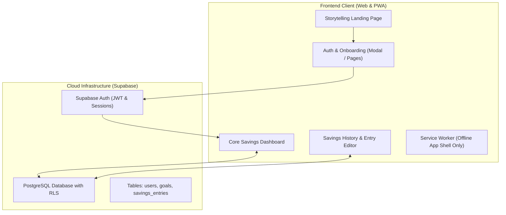

# 📋 NairaStreak Labs — Project Handoff

> **Parent Organization**: NairaStreak Labs  
> **Working Product Title**: 500K Challenge *(Temporary working name pending final consumer product naming)*  
> **Original Author**: Zuokemefa Oyinmiebi Peter (Learn2earn)  
> **Original Live Deployment**: [https://500ksavgoal.netlify.app](https://500ksavgoal.netlify.app) *(DO NOT overwrite or modify)*  
> **Target New Deployment**: Netlify (e.g. `nairastreak-web.netlify.app` / custom domain)  
> **Document Version**: 2.0 (Post-Directive Revision)  
> **Date**: October 12, 2026  

---

## 1. Directive Context & Foundation Goal

This project is undergoing a structured transition from an inherited single-file prototype into an end-to-end, production-grade web product under **NairaStreak Labs**.

### Core Tenets
1. **Parent Brand vs Product Name**:
   - `NairaStreak Labs` is the parent organization.
   - `500K Challenge` is solely a working product title. Architecture, database schemas, and API contracts are designed to support arbitrary goals and multi-goal capabilities.
2. **Attribution & Preservation**:
   - Original author Zuokemefa Oyinmiebi Peter is preserved in UI and documentation.
   - The original Netlify deployment will remain untouched.
3. **Primary Product Goal**:
   - Deliver one complete customer journey before any advanced or native mobile feature development:
     `Landing Page -> Sign Up / Log In -> Onboarding -> Create Savings Goal -> Dashboard -> Log Savings -> See Progress -> View History -> Return Later -> Log In -> Continue from Same Data`.

---

## 2. Technical Inventory & Baseline Architecture

### 2.1 File Map
```
500k-Savings-Challenge/
├── AGENTS.md               # AI agent operational guidelines & boundaries
├── CHANGELOG.md            # Version and release history
├── HANDOFF.md              # Central transition handoff document
├── README.md               # Repository documentation and badges
├── index.html              # Inherited monolithic prototype (UI, CSS, JS)
├── manifest.json           # Web App Manifest
├── sw.js                   # Service Worker (cache shell & notifications)
├── icon-192.png            # 192x192 app icon
├── icon-512.png            # 512x512 app icon
└── docs/                   # Full Phase 0 discovery and architecture docs
```

### 2.2 Baseline Technical Assessment & Debt
- **Single-File Monolith**: `index.html` (900+ lines) contains HTML markup, inline styles, and JavaScript logic mingled together.
- **Client-Only Persistence**: Relies solely on `localStorage` (`savings500k`, `savings500k_settings`, etc.). Data is lost if users switch browsers or clear device cache.
- **Zero Authentication**: No user accounts or authentication. Anyone opening the browser accesses the local state.
- **Hardcoded 500K Assumption**: Default values, copy, and calculations reference ₦500,000, which must be made dynamically configurable.
- **Service Worker Caching**: Currently caches `index.html` statically. When moving to dynamic API/Auth, caching rules must strictly avoid caching auth tokens or private user data.

---

## 3. Web V1 Architecture & Transition Strategy



### 3.1 Recommended Technology Decisions
- **Authentication**: **Supabase Auth** (email/password, password reset, session persistence, secure HTTP-only cookie or memory token handling). Eliminates homegrown auth risks.
- **Persistence**: **Supabase PostgreSQL** with Row Level Security (RLS). Guarantees complete cross-user data isolation.
- **Data Migration**: Non-destructive client migration path (`localStorage` entries exported/imported into the authenticated user's first goal).
- **Hosting**: Independent Netlify deployment (`nairastreak-web.netlify.app`), fully decoupled from the original prototype.

---

## 4. Documentation Index

The repository features comprehensive Phase 0 documentation in the `docs/` directory:

| Document | Purpose |
| :--- | :--- |
| [`PRD.md`](file:///home/tim/project8B/500k-Savings-Challenge/docs/PRD.md) | Product Requirements Document for Web V1 |
| [`BRAND_IDENTITY.md`](file:///home/tim/project8B/500k-Savings-Challenge/docs/BRAND_IDENTITY.md) | Brand identity guidelines for NairaStreak Labs |
| [`USER_PERSONAS.md`](file:///home/tim/project8B/500k-Savings-Challenge/docs/USER_PERSONAS.md) | Target saver personas and behavioral profiles |
| [`USER_FLOWS.md`](file:///home/tim/project8B/500k-Savings-Challenge/docs/USER_FLOWS.md) | Step-by-step user journey diagrams and interactions |
| [`WEB_APP_PLAN.md`](file:///home/tim/project8B/500k-Savings-Challenge/docs/WEB_APP_PLAN.md) | Implementation blueprint and modularization steps |
| [`MOBILE_ROADMAP.md`](file:///home/tim/project8B/500k-Savings-Challenge/docs/MOBILE_ROADMAP.md) | Strategy for post-V1 mobile clients |
| [`ARCHITECTURE.md`](file:///home/tim/project8B/500k-Savings-Challenge/docs/ARCHITECTURE.md) | System components, API flows, and security boundaries |
| [`DATA_MODEL.md`](file:///home/tim/project8B/500k-Savings-Challenge/docs/DATA_MODEL.md) | Relational schema (`users`, `goals`, `savings_entries`) & RLS |
| [`PWA_REQUIREMENTS.md`](file:///home/tim/project8B/500k-Savings-Challenge/docs/PWA_REQUIREMENTS.md) | Progressive Web App standards, service worker cache rules |
| [`DESIGN_GUIDELINES.md`](file:///home/tim/project8B/500k-Savings-Challenge/docs/DESIGN_GUIDELINES.md) | Typography, color palette, responsive breakpoints, a11y |
| [`FEATURE_SPEC.md`](file:///home/tim/project8B/500k-Savings-Challenge/docs/FEATURE_SPEC.md) | Detailed specifications for each dashboard feature |
| [`SECURITY_PRIVACY.md`](file:///home/tim/project8B/500k-Savings-Challenge/docs/SECURITY_PRIVACY.md) | Data protection, RLS enforcement, non-custodial privacy |
| [`LEGAL_COMPLIANCE.md`](file:///home/tim/project8B/500k-Savings-Challenge/docs/LEGAL_COMPLIANCE.md) | Disclaimers, privacy policy outline, NDPR compliance |
| [`ORIGIN_AND_ATTRIBUTION.md`](file:///home/tim/project8B/500k-Savings-Challenge/docs/ORIGIN_AND_ATTRIBUTION.md) | Project origin, author credits, and deployment history |
| [`RESOURCES.md`](file:///home/tim/project8B/500k-Savings-Challenge/docs/RESOURCES.md) | Tooling, CDN libraries, assets, and design references |
| [`TEST_PLAN.md`](file:///home/tim/project8B/500k-Savings-Challenge/docs/TEST_PLAN.md) | Testing matrix for customer journeys and edge cases |
| [`DEPLOYMENT_CHECKLIST.md`](file:///home/tim/project8B/500k-Savings-Challenge/docs/DEPLOYMENT_CHECKLIST.md) | Zero-downtime Netlify production deployment checklist |
| [`PRODUCTION_QUALITY.md`](file:///home/tim/project8B/500k-Savings-Challenge/docs/PRODUCTION_QUALITY.md) | Code quality, accessibility, Core Web Vitals targets |
| [`DECISIONS.md`](file:///home/tim/project8B/500k-Savings-Challenge/docs/DECISIONS.md) | Architecture Decision Records (ADR 001 - ADR 005) |
| [`ROADMAP.md`](file:///home/tim/project8B/500k-Savings-Challenge/docs/ROADMAP.md) | Complete multi-phase execution roadmap |

---

## 5. Next Steps

Execution must proceed in strict phases. Implementation will begin only after Phase 0 discovery and documentation are fully reviewed and approved.
