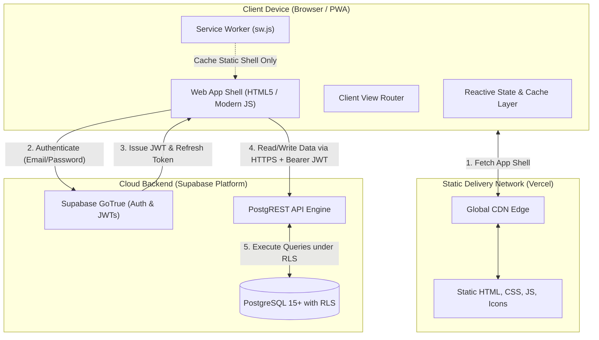
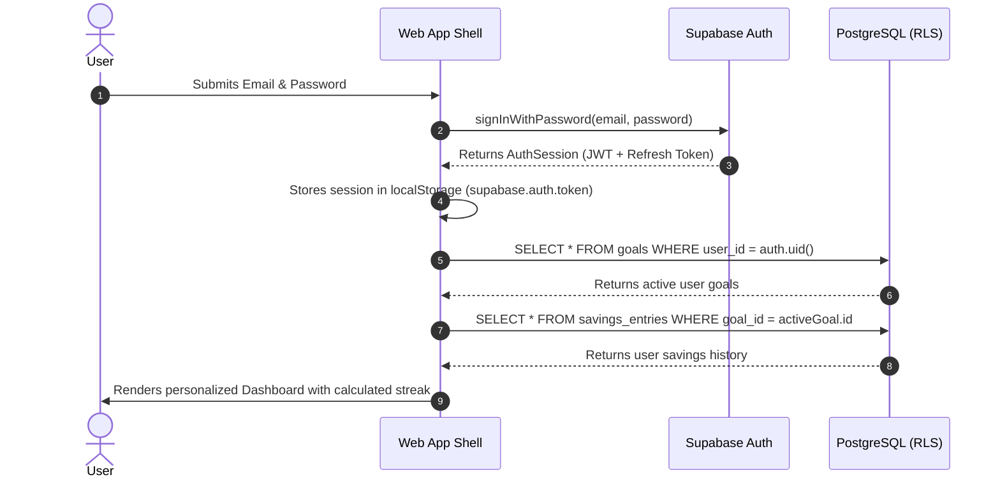
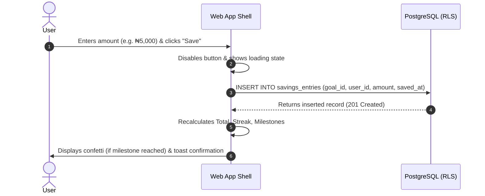

# Architecture Documentation — Web V1

> **Parent Organization**: NairaStreak Labs  
> **Target Release**: Web V1  
> **Infrastructure Model**: Client-Side Single Page Application (SPA/PWA) + Managed Backend-as-a-Service (Supabase) + Static CDN (Vercel)

---

## 1. System Topology Overview

---

## 2. Component Specifications

### 2.1 Static Edge Tier (Vercel)
- **Role**: Serves immutable frontend application code (HTML, CSS, modular JS, images, PWA manifest) over HTTPS with HTTP/2 and Brotli compression.
- **Independence**: Fully decoupled from `https://500ksavgoal.netlify.app`. Deployed to a new site instance (e.g. `nairastreak.vercel.app`).
- **Security Headers**: Content Security Policy (CSP), X-Frame-Options, Strict-Transport-Security, and X-Content-Type-Options configured in `vercel.json`.

### 2.2 Client Application Tier (Frontend)
- **View Router**: Lightweight state or hash router managing navigation between `/` (Public Landing), `#dashboard` / `#app`, and `#recovery`.
- **Auth Guard**: Middleware checking `currentUser` session before mounting `#dashboard` or `#app`. Redirects unauthenticated visitors to `#landing` and prompts Sign In modal.
- **Config Layer (`config.js`)**: Encapsulates browser-safe Supabase URL and anon public key on `window.NAIRASTREAK_CONFIG`. Never exposes service-role keys.
- **Service Worker (`sw.js`)**:
  - Serves static app shell assets during network outages (`nairastreak-auth-v2`).
  - **Explicit Security Constraint**: Strictly configured to NEVER intercept or cache requests to Supabase API endpoints (`*.supabase.co`) or store JWT auth tokens in Cache Storage. Enforces `networkResponse.type === 'basic'`.

### 2.3 Cloud Persistence & Auth Tier (Supabase)
- **Authentication**: Managed GoTrue service handling user registration, password hashing (bcrypt), session tokens, and password reset workflows. Connected to remote project `mtkzbyhquwhipgyusrjs` (region `eu-west-1`).
- **Database**: Managed PostgreSQL database storing relational records (`profiles`, `goals`, `savings_entries`).
- **Row Level Security (RLS)**: Enforces complete multi-tenant isolation at the database engine level using optimized `(select auth.uid())` policy checks. Even if a malicious request attempts to read records belonging to another `user_id`, the database query returns 0 rows. Verified with 0 advisor linter warnings.

---

## 3. Data & Communication Sequence

### 3.1 Authentication & Session Hydration Flow

### 3.2 Savings Entry Mutation Flow

## Stabilize cloud ledger
`ledger.js` queries all pages of the active goal's savings entries on dashboard
and history entry. Per-user/per-goal localStorage is an offline cache, never an
upload source. `ledger-ui.js` provides confirmed cloud CRUD, custom amounts,
recalculation, loading/error states and retries. Legacy savings500k keys are
preserved and never implicitly attached to an account. Browser and live backend
journeys still require verification; Node tests exercise a mocked data provider.
