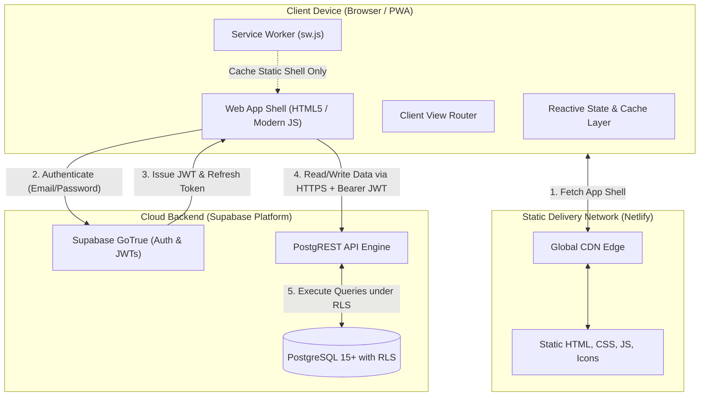
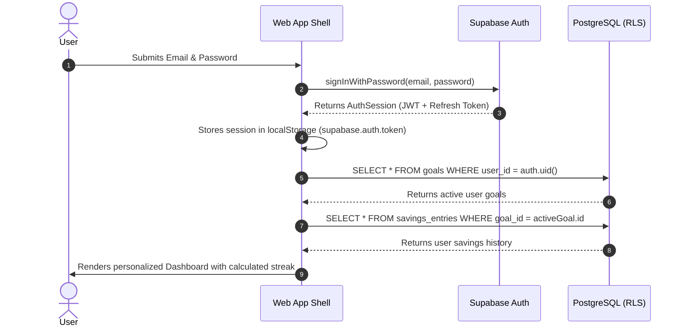
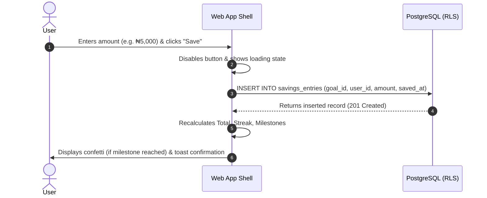

# Architecture Documentation — Web V1

> **Parent Organization**: NairaStreak Labs  
> **Target Release**: Web V1  
> **Infrastructure Model**: Client-Side Single Page Application (SPA/PWA) + Managed Backend-as-a-Service (Supabase) + Static CDN (Netlify)

---

## 1. System Topology Overview

---

## 2. Component Specifications

### 2.1 Static Edge Tier (Netlify)
- **Role**: Serves immutable frontend application code (HTML, CSS, modular JS, images, PWA manifest) over HTTPS with HTTP/2 and Brotli compression.
- **Independence**: Fully decoupled from `https://500ksavgoal.netlify.app`. Deployed to a new site instance (e.g. `nairastreak-web.netlify.app`).
- **Security Headers**: Content Security Policy (CSP), X-Frame-Options, Strict-Transport-Security, and X-Content-Type-Options configured in `_headers` or `netlify.toml`.

### 2.2 Client Application Tier (Frontend)
- **View Router**: Lightweight state or hash router managing navigation between `/` (Public Landing), `/onboarding`, `/dashboard`, `/history`, and `/settings`.
- **Auth Guard**: Middleware checking session presence before mounting protected routes. Redirects unauthenticated users to the public landing page.
- **Service Worker (`sw.js`)**:
  - Serves static app shell assets during network outages.
  - **Explicit Security Constraint**: Strictly configured to NEVER intercept or cache requests to Supabase API endpoints (`*.supabase.co`) or store JWT auth tokens in Cache Storage.

### 2.3 Cloud Persistence & Auth Tier (Supabase)
- **Authentication**: Managed GoTrue service handling user registration, password hashing (bcrypt), session tokens, and password reset workflows.
- **Database**: Managed PostgreSQL database storing relational records (`users`, `goals`, `savings_entries`).
- **Row Level Security (RLS)**: Enforces complete multi-tenant tenant isolation at the database engine level. Even if a malicious request attempts to read records belonging to another `user_id`, the database query returns 0 rows.

---

## 3. Data & Communication Sequence

### 3.1 Authentication & Session Hydration Flow

### 3.2 Savings Entry Mutation Flow

