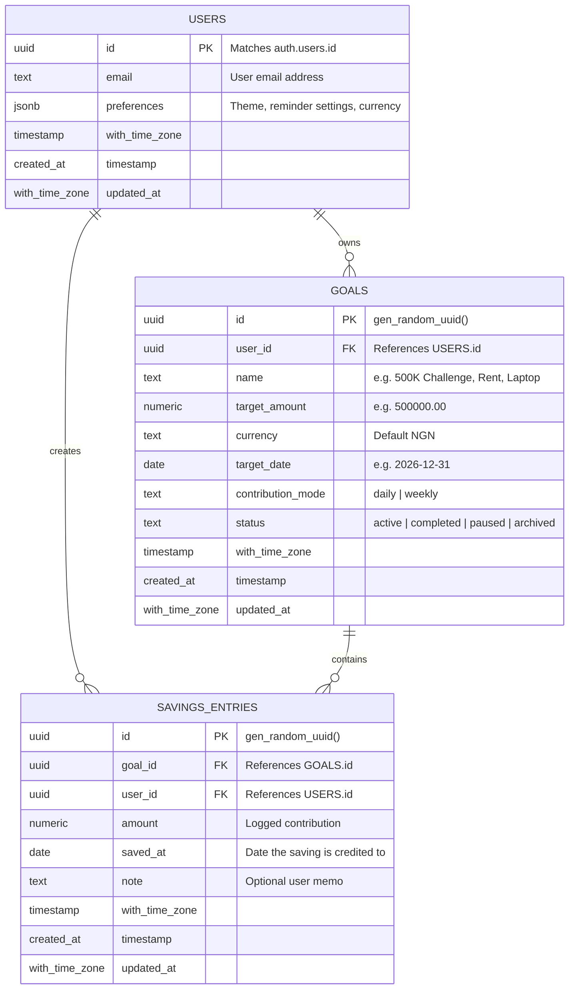

# Data Model & Schema Specification

> **Parent Organization**: NairaStreak Labs  
> **Database Engine**: PostgreSQL 15+ (via Supabase)  
> **Security Model**: Row Level Security (RLS) mandatory on all tables

---

## 1. Relational Schema Architecture



---

## 2. Table Definitions & SQL DDL

```sql
-- 1. PROFILES / USERS TABLE
CREATE TABLE public.profiles (
    id UUID PRIMARY KEY REFERENCES auth.users(id) ON DELETE CASCADE,
    email TEXT NOT NULL,
    preferences JSONB DEFAULT '{"darkMode": false, "remindersOn": false, "reminderTimes": ["09:00", "14:00", "20:00"]}'::jsonb,
    created_at TIMESTAMP WITH TIME ZONE DEFAULT timezone('utc'::text, now()) NOT NULL,
    updated_at TIMESTAMP WITH TIME ZONE DEFAULT timezone('utc'::text, now()) NOT NULL
);

-- Trigger to create profile automatically on auth signup
CREATE OR REPLACE FUNCTION public.handle_new_user()
RETURNS TRIGGER AS $$
BEGIN
    INSERT INTO public.profiles (id, email)
    VALUES (NEW.id, NEW.email);
    RETURN NEW;
END;
$$ LANGUAGE plpgsql SECURITY DEFINER;

CREATE TRIGGER on_auth_user_created
    AFTER INSERT ON auth.users
    FOR EACH ROW EXECUTE PROCEDURE public.handle_new_user();


-- 2. GOALS TABLE
CREATE TABLE public.goals (
    id UUID PRIMARY KEY DEFAULT gen_random_uuid(),
    user_id UUID NOT NULL REFERENCES public.profiles(id) ON DELETE CASCADE,
    name TEXT NOT NULL DEFAULT '500K Challenge',
    target_amount NUMERIC(12, 2) NOT NULL CHECK (target_amount > 0),
    currency TEXT NOT NULL DEFAULT 'NGN',
    target_date DATE NOT NULL,
    contribution_mode TEXT NOT NULL DEFAULT 'daily' CHECK (contribution_mode IN ('daily', 'weekly')),
    status TEXT NOT NULL DEFAULT 'active' CHECK (status IN ('active', 'completed', 'paused', 'archived')),
    created_at TIMESTAMP WITH TIME ZONE DEFAULT timezone('utc'::text, now()) NOT NULL,
    updated_at TIMESTAMP WITH TIME ZONE DEFAULT timezone('utc'::text, now()) NOT NULL
);

CREATE INDEX idx_goals_user_id ON public.goals(user_id);


-- 3. SAVINGS ENTRIES TABLE
CREATE TABLE public.savings_entries (
    id UUID PRIMARY KEY DEFAULT gen_random_uuid(),
    goal_id UUID NOT NULL REFERENCES public.goals(id) ON DELETE CASCADE,
    user_id UUID NOT NULL REFERENCES public.profiles(id) ON DELETE CASCADE,
    amount NUMERIC(12, 2) NOT NULL CHECK (amount > 0),
    saved_at DATE NOT NULL DEFAULT CURRENT_DATE,
    note TEXT,
    created_at TIMESTAMP WITH TIME ZONE DEFAULT timezone('utc'::text, now()) NOT NULL,
    updated_at TIMESTAMP WITH TIME ZONE DEFAULT timezone('utc'::text, now()) NOT NULL
);

CREATE INDEX idx_entries_goal_id ON public.savings_entries(goal_id);
CREATE INDEX idx_entries_user_saved_at ON public.savings_entries(user_id, saved_at);
```

---

## 3. Row Level Security (RLS) & Multi-Tenant Isolation

Row Level Security is enabled by default to enforce tenant isolation at the database layer.

```sql
-- Enable RLS
ALTER TABLE public.profiles ENABLE ROW LEVEL SECURITY;
ALTER TABLE public.goals ENABLE ROW LEVEL SECURITY;
ALTER TABLE public.savings_entries ENABLE ROW LEVEL SECURITY;

-- Profiles Policies
CREATE POLICY "Users can view own profile" 
    ON public.profiles FOR SELECT USING (auth.uid() = id);

CREATE POLICY "Users can update own profile" 
    ON public.profiles FOR UPDATE USING (auth.uid() = id);

-- Goals Policies
CREATE POLICY "Users can view own goals" 
    ON public.goals FOR SELECT USING (auth.uid() = user_id);

CREATE POLICY "Users can insert own goals" 
    ON public.goals FOR INSERT WITH CHECK (auth.uid() = user_id);

CREATE POLICY "Users can update own goals" 
    ON public.goals FOR UPDATE USING (auth.uid() = user_id);

CREATE POLICY "Users can delete own goals" 
    ON public.goals FOR DELETE USING (auth.uid() = user_id);

-- Savings Entries Policies
CREATE POLICY "Users can view own entries" 
    ON public.savings_entries FOR SELECT USING (auth.uid() = user_id);

CREATE POLICY "Users can insert own entries" 
    ON public.savings_entries FOR INSERT WITH CHECK (auth.uid() = user_id);

CREATE POLICY "Users can update own entries" 
    ON public.savings_entries FOR UPDATE USING (auth.uid() = user_id);

CREATE POLICY "Users can delete own entries" 
    ON public.savings_entries FOR DELETE USING (auth.uid() = user_id);
```

---

## 4. Migration Strategy: `localStorage` to Cloud Database

To ensure existing prototype users do not lose their logged savings:
1. **Detection**: Upon successful login, the application checks if legacy keys (`savings500k` and `savings500k_settings`) exist in the browser's `localStorage`.
2. **Migration Prompt**: A modal appears: *"We detected existing offline savings on this device. Would you like to import them to your account?"*
3. **Execution**:
   - The user's goal parameters are written to `public.goals`.
   - Each entry in `savings500k` is mapped:
     `{ goal_id, user_id: auth.uid(), amount: e.amount, saved_at: e.date, note: e.note || null }`
   - Batch insert sent to `public.savings_entries`.
4. **Archive & Cleanup**: Once the cloud confirmation arrives, `localStorage` legacy entries are tagged as migrated (e.g. `savings500k_migrated: true`) and archived safely to prevent duplicate double-imports.
