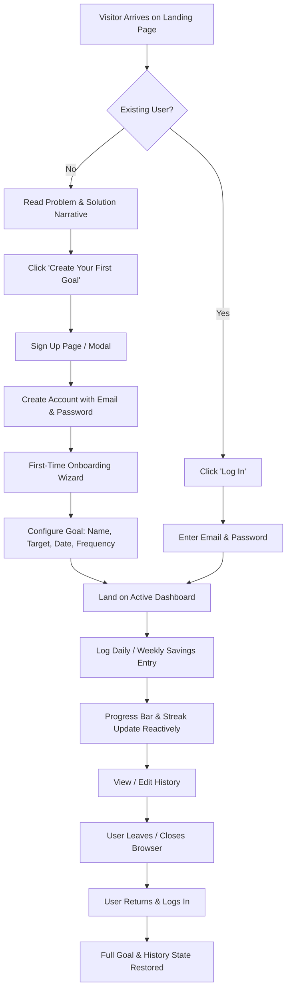

# User Flows — Web V1

> **Parent Organization**: NairaStreak Labs  
> **Document Scope**: End-to-end user navigation diagrams and state transitions.

---

## 1. Primary Customer Journey



---

## 2. Detailed Sub-Flows

### 2.1 Public Landing Page Flow
```
Visitor on /
  │
  ├── 1. Hero: Relates to anxiety of inconsistent saving
  ├── 2. Problem: ₦500k is intimidating; daily consistency is hard
  ├── 3. Transformation: Break big goal into small daily habits
  ├── 4. Interactive Calculator: Try arbitrary amounts & deadlines
  ├── 5. Interactive Dashboard Mockup: Preview streak & progress bar
  ├── 6. Trust & Privacy Banner: Zero custody; we track habits, not money
  └── 7. Primary CTA: "Get Started Free" -> Opens Sign Up
```

### 2.2 First-Time Onboarding Flow
```
Account Verified
  │
  ▼
Step 1: Welcome Screen ("What are you saving for?")
  │  Options: [Emergency Fund, Rent, Laptop, ₦500K Challenge, Custom]
  ▼
Step 2: Set Target Amount & Currency (e.g., ₦500,000)
  ▼
Step 3: Select Target Deadline (e.g., 2026-12-31)
  ▼
Step 4: Choose Cadence (Daily vs. Weekly)
  ▼
Step 5: Plan Summary Review
  │  Display: "To save ₦500,000 by Dec 31, 2026, you need ₦3,676 / day"
  ▼
Step 6: Click "Launch My Goal" -> Persist Goal to Database -> Open Dashboard
```

### 2.3 Savings Logging & Feedback Flow
```
Dashboard View
  │
  ▼
User selects Quick Preset (e.g. ₦3,676) OR enters Custom Amount (e.g. ₦5,000)
  │
  ├── (Optional) Enter note: "Freelance milestone payout"
  ▼
Click "Log Savings"
  │
  ├── 1. Disable submit button (prevent double submissions)
  ├── 2. Dispatch payload to database (or optimistic local update)
  ├── 3. Recalculate Total Saved, Remaining, and Percentage
  ├── 4. If saving qualifies for streak increment -> Increment Streak
  ├── 5. Check milestone threshold (25%, 50%, 75%, 100%)
  │      └── If crossed -> Trigger celebration confetti & modal
  ├── 6. Show confirmation toast: "Saved! Keep it up 🌱"
  └── 7. Append record to Recent History ledger
```

### 2.4 History Ledger Flow (Edit / Delete)
```
History List
  │
  ├── Click 'Edit'
  │     ├── Open inline editor with amount, date, and note
  │     ├── Submit -> Update entry in DB -> Recalculate totals & pace
  │     └── Close editor
  │
  └── Click 'Delete'
        ├── Trigger confirmation dialog: "Are you sure you want to remove this entry?"
        ├── Confirm -> Remove entry from DB
        ├── Recalculate streak, total saved, and milestones
        └── Show undo toast / confirm deletion
```

### 2.5 Returning User Session Flow
```
User visits app URL
  │
  ▼
Check persistent session (Supabase Auth token in secure storage)
  │
  ├── Session Valid -> Hydrate user goals and entries -> Display Dashboard
  │
  └── Session Expired / Null -> Redirect to Landing Page with "Log In" active
```
